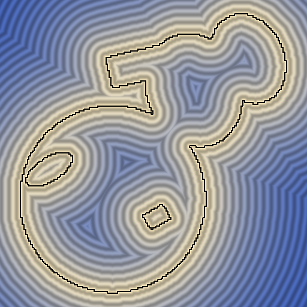

# ДЗ 3: Использование ускоряющих структур при работе с геометрией

## Постановка задачи
Решение задач 3D компьютерного зрения часто требует использования различных методов анализа изображений и геометрии. Как было показано на лекции SfM, пайплайны 3DCV могут быть очень длинными и запутанными. Чтобы добиться их приемлемой производительности, необходимо эффективно реализовывать выполнение подзадач, многократно исполняемых в основном алгоритме. Для этого их реализуют как программы на языках, позволяющих писать высокопроизводительный код (С, С++, Rust) и, при необходимости, предоставляют API на Python. Так, в частности, устроены популярные библиотеки Numpy, OpenCV, PyTorch и т.д.

В этом задании вам предлагается реализовать и сравнить несколько ускоряющих структур для задачи поиска расстояния до профиля. Под профилем мы понимаем множество замкнутых кривых. Кривые состоят из отрезков, замкнуты и не имеют самопересечений. Кривые одного профиля не пересекаются друг с другом. Гарантируется, что общее количество отрезков в кривых одного профиля не превышает 2^16 - 1.

С этим заданием вам предоставлен шаблон решения: функция вычисления дистанции до профиля вызывается для массива точек, формирующих равномерную сетку, после чего массив превращается в изображение (distance_image(...)) и сохраняется на диск.

От вас требуется сдать несколько реализаций вычисления дистанции до профиля: от наивного перебора всех отрезков до использования вспомогательных структур данных: регулярной сетки, quadtree, BVH.

Вам даны три файла с профилями разных размеров (по 100 штук в каждом): profiles_small.bin, profiles_medium.bin, profiles_large.bin и функция их чтения.

### Часть 1: Brute force
Реализуйте функцию segment_distance - distance_brute_force вызывает ее, чтобы подсчитать дистанцию до профиля как минимум дистанции для всех его сегментов. Запустите программу на простых профилях, сохраните изображения как reference profiles_small.bin

Пример изображения для сложного профиля из 3 кривых.

### Часть 2: Ускоряющие структуры
Реализуйте последовательно три ускоряющие структуры и поиск ближайшего сегмента с их помощью:
1) Регулярная сетка, каждая ячейка содержит количество и список сегментов, ее пересекающих
2) Quadtree, каждый листовой узел содержит количество и список сегментов
3) BVH, каждый листовой узел содержит количество и список сегментов

### Часть 3: Эксперименты
Проведите эксперименты на всех заданных профилях. Учитывайте время, затраченное на построение структур данных. Какая ускоряющая структура
показала наилучший результат? Какого ускорения удалось добиться и как оно изменяется в зависимости от количество сегментов в профиле?
